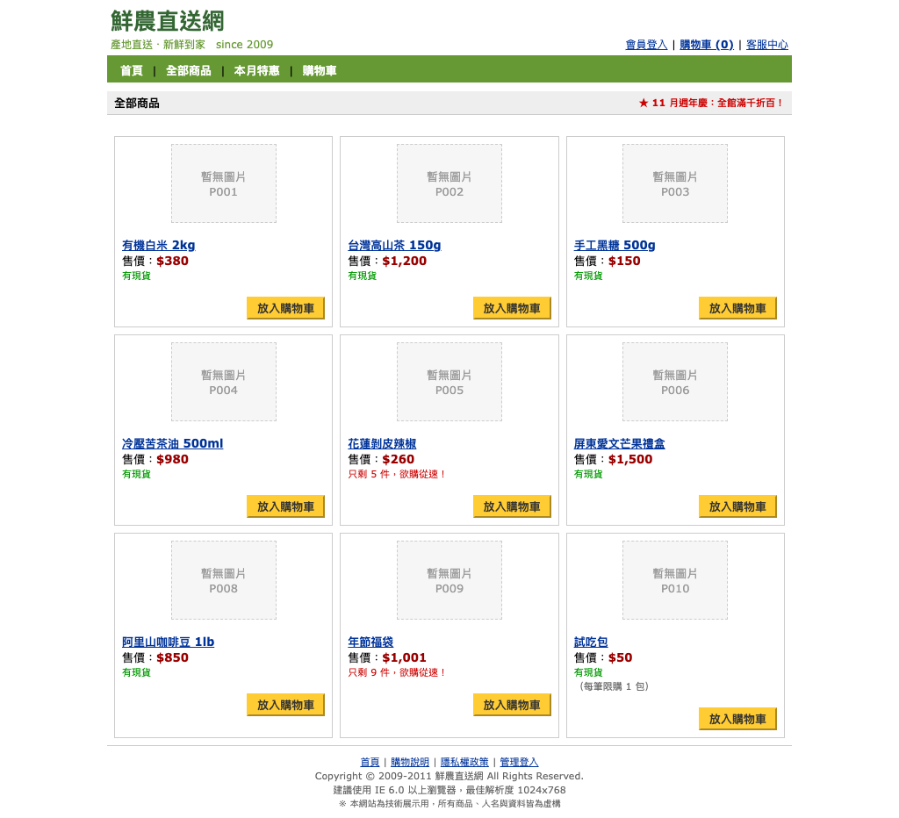
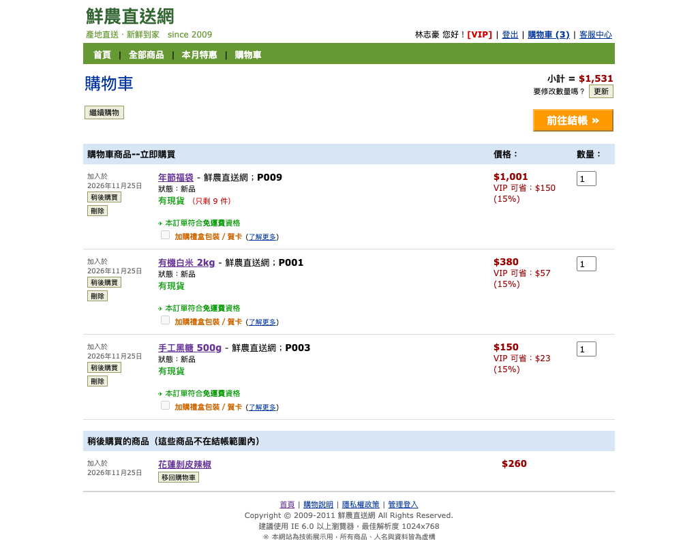
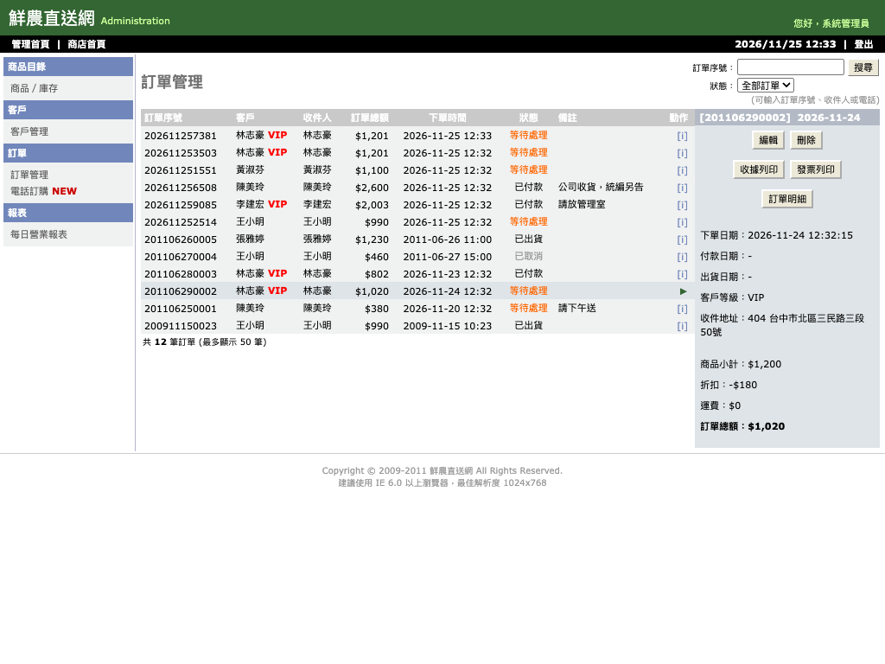
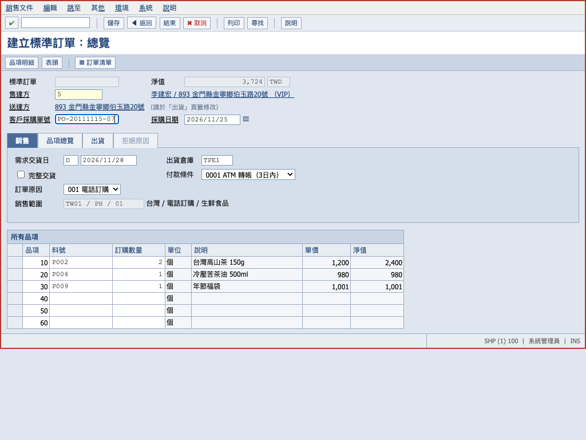
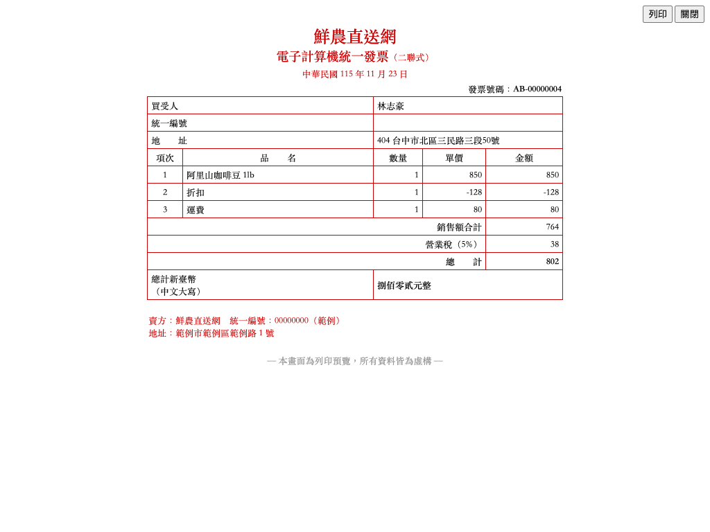
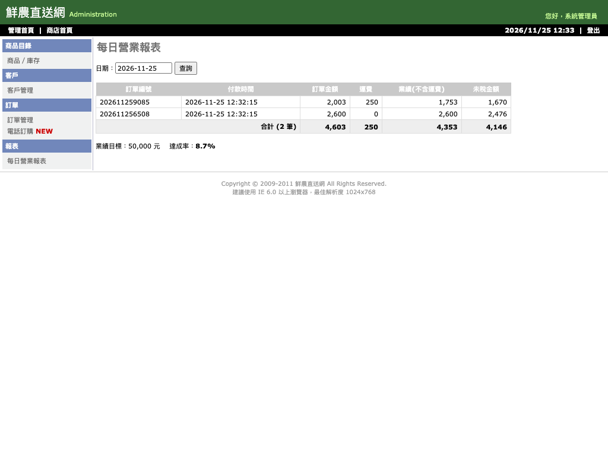

# php2awas：PHP4 舊系統現代化 Demo

一套**可以實際執行**的 2009 年風格舊訂單系統（PHP4 語法 + CodeIgniter 1.7），搭配 138 個特性測試，用來示範如何用 Kiro 把它改寫成 AWS Serverless（SAM）。

> ⚠️ **所有內容都是虛構的**：商店、人名、email（皆為 `example.com`）、帳密、金鑰、銀行帳號、統一編號都是假資料。程式碼**刻意**埋了 SQL Injection、萬用密碼等資安漏洞，僅供教學展示，**請勿部署到任何公開環境**。

- **Demo 計畫與腳本**：[kiro_demo_modernization.md](kiro_demo_modernization.md)
- **測試案例、規則總表、Bug 清單**：[tests/TEST_CASES.md](tests/TEST_CASES.md)

## 畫面

畫面參考當年的三種典型系統：osCommerce 風格的網店後台、SAP GUI 風格的 ERP 下單畫面，以及 2009 年的 Amazon 購物車。HTML、CSS、JavaScript 也都照當年的寫法：table 排版、`<font>` 標籤、`onmouseover="rowOverEffect(this)"`，AJAX 則用 `ActiveXObject("Microsoft.XMLHTTP")`。

| 前台首頁 | 購物車（稍後購買、VIP 可省） |
|---|---|
|  |  |

| 後台訂單管理（osCommerce 風格） | 電話訂購（仿 ERP「建立標準訂單」） |
|---|---|
|  |  |

| 發票列印 | 每日營業報表 |
|---|---|
|  |  |

其他截圖：[結帳](docs/screenshots/03_shop_checkout.png)、[訂單完成](docs/screenshots/04_shop_done.png)、[後台登入](docs/screenshots/05_admin_login.png)、[客戶管理](docs/screenshots/07_admin_customers.png)、[收據列印](docs/screenshots/10_admin_receipt.png)、[前人留下的 CI 單元測試（有一條是紅的）](docs/screenshots/12_ci_unit_test.png)

## 目錄

| 路徑 | 內容 |
|---|---|
| [legacy_demo/](legacy_demo/) | 舊系統：CodeIgniter 1.7.2 加業務程式（約 2,860 行 PHP），以及 css、js、MySQL schema 和種子資料 |
| [runtime/](runtime/) | 讓舊系統跑起來的 Docker 環境：PHP 5.6 + Apache、MariaDB 10.6 |
| [tests/characterization/](tests/characterization/) | pytest 特性測試，可以切換測舊系統或新系統 |
| [tests/TEST_CASES.md](tests/TEST_CASES.md) | 人看的測試案例 |
| [tools/screenshots/](tools/screenshots/) | 重新產生截圖的腳本（puppeteer-core） |
| [docs/screenshots/](docs/screenshots/) | 畫面截圖 |

## 啟動舊系統

需要先安裝 Docker。

```bash
cd runtime
docker compose up -d --build
```

| 用途 | 網址 | 帳號 |
|---|---|---|
| 前台購物網站 | <http://localhost:8080/> | 會員：`chihhao.lin@example.com` / `123456`（VIP） |
| 後台 | <http://localhost:8080/index.php/admin/login> | `admin` / `admin123` |
| 電話訂購 | <http://localhost:8080/index.php/admin/phone_order> | 後台登入後使用 |
| 建單 API | `POST /index.php/api/order/create` | |
| 查詢 API | `GET  /index.php/api/order/query/{訂單編號}` | |
| 取消 API | `POST /index.php/api/order/cancel` | |
| 庫存 API | `GET  /index.php/api/product/stock/{商品ID}` | |
| 付款通知 | `POST /index.php/api/payment/notify` | |
| 排程 | `GET  /index.php/cron/auto_cancel` | |
| 資料庫 | `localhost:3307` | `root` / `shop@1234`，資料庫 `shopdb` |
| 寄出的信 | `runtime/mail-out/mail.log` | |

```bash
# 試下一筆訂單：VIP 會員，11 月
curl -d "member_id=3&items=2:1,3:2&receiver=林志豪&phone=0912&zip=404&address=台中&debug_now=2011-11-05 10:00:00" \
     http://localhost:8080/index.php/api/order/create
# → OK|20111105xxxx|1175

# 重設資料
cat ../legacy_demo/sql/01_schema.sql ../legacy_demo/sql/02_seed_data.sql \
  | docker compose exec -T db mariadb -uroot -pshop@1234

# 關閉並清除資料
docker compose down -v
```

## 執行特性測試

```bash
cd tests/characterization
pip install -r requirements.txt   # 只需要 pytest
pytest -q                         # 138 passed
TARGET=new pytest -q              # 用新系統標準檢查：5 failed（API 層級的已知 Bug）
pytest -m race -s                 # 重現併發超賣
```

切換成新系統時要設定的環境變數，請見 [tests/README.md](tests/README.md)。

## 執行環境說明

| 項目 | 當年（故事設定） | 這份 Demo | 原因 |
|---|---|---|---|
| PHP | 4.4 | 5.6.40 | PHP4 已經沒有可用的 Docker image；5.6 是最後一個還有 `mysql_*` 的版本 |
| 程式語法 | PHP4 | PHP4 | 沒有使用任何 PHP5 以後的語法（已用 grep 檢查） |
| 框架 | CodeIgniter 1.7.x | CodeIgniter 1.7.2 | |
| 資料庫 | MySQL 5.0（MyISAM） | MariaDB 10.6（MyISAM、`sql_mode=''`） | Apple Silicon 沒有 MySQL 5.x 的 arm64 image |
| 前端 | IE 6 | 任何瀏覽器 | HTML 4.01 Transitional，沒有用到 CSS3 |

## 授權

`legacy_demo/system/` 與 `legacy_demo/index.php` 是 CodeIgniter 1.7.2 的原始碼，著作權屬於 EllisLab, Inc.，授權條款見 [legacy_demo/license.txt](legacy_demo/license.txt)。框架核心（`system/` 底下 `application/` 以外的部分）沒有修改；修改過的 CI 設定檔都已在檔頭加註修改內容。業務程式、css、js、測試和文件則是本 Demo 新增的。
