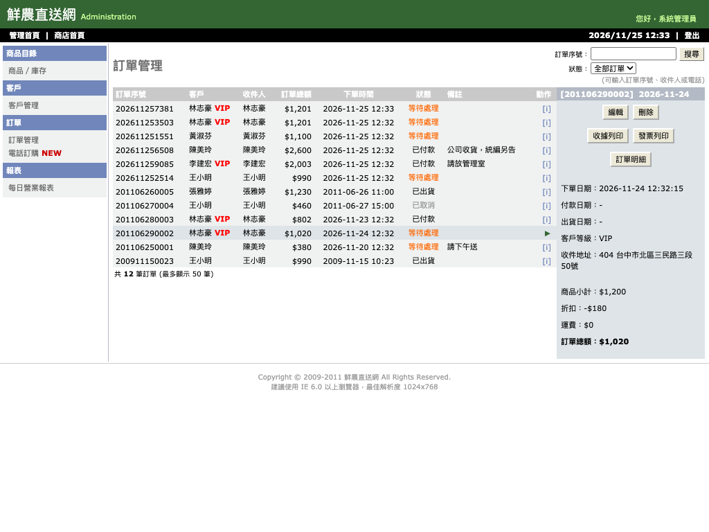
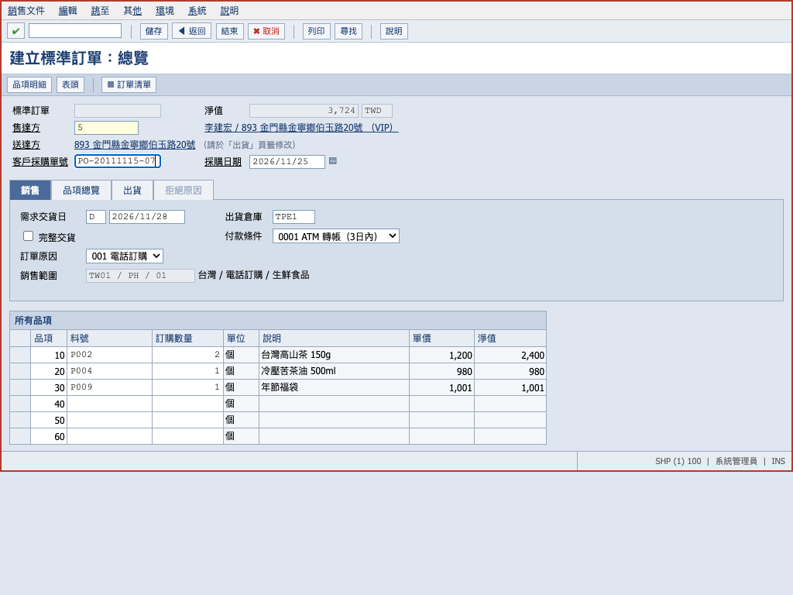
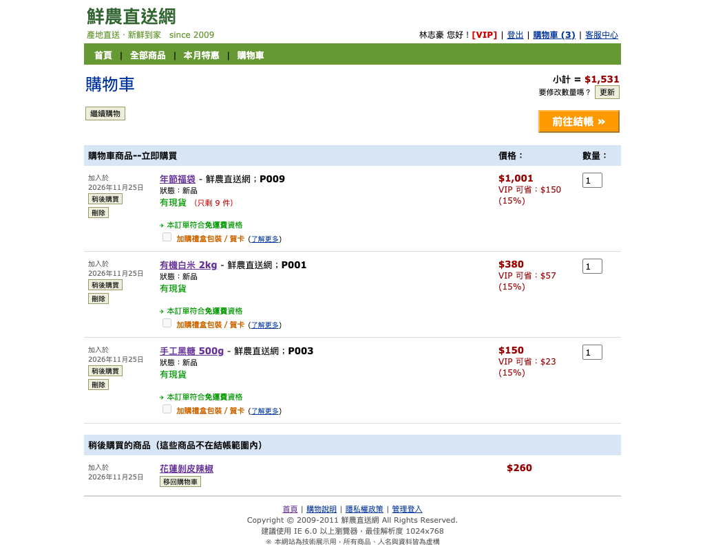
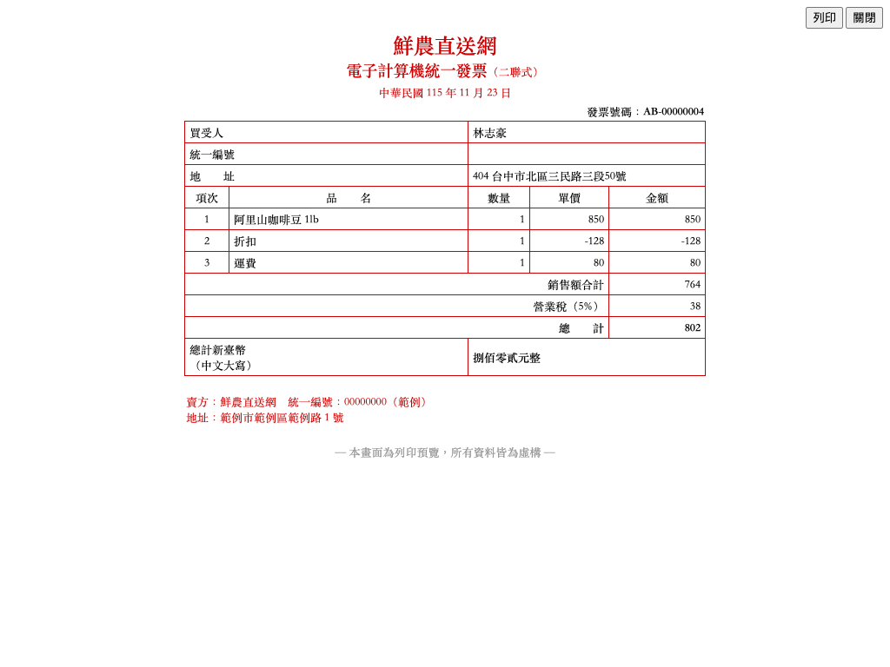
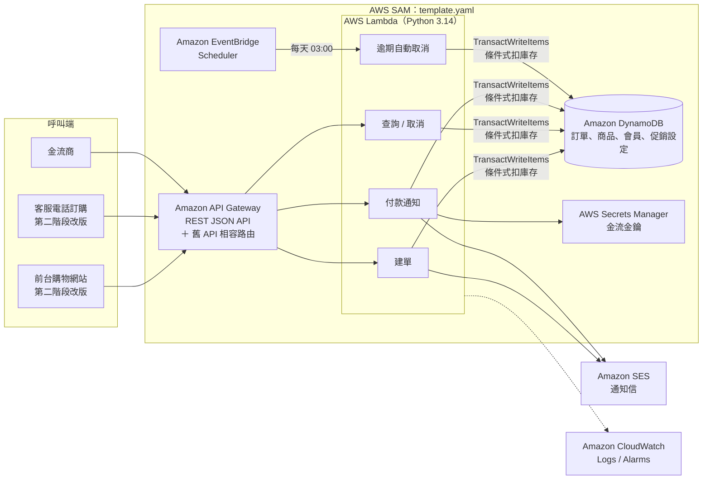

# Kiro Demo 計畫：PHP4 舊訂單系統現代化到 AWS Serverless（SAM）

> **一句話**：PHP 爆出 php2shell 漏洞，連日本首相都出面呼籲修補，但這套 PHP4 + CodeIgniter 1.7 的訂單系統**根本沒有修補可以套用**。我們用 Kiro **看懂 → 釘住行為 → 規格 → 改寫 → 自動驗證**，把它搬到 AWS Serverless。

| 項目 | 內容 |
|---|---|
| 時間 | 約 30～35 分鐘 |
| 素材 | `legacy_demo/`：可以實際執行的舊系統（CodeIgniter 1.7.2、PHP4 語法、MySQL），包含前台購物網站、osCommerce 風格後台、仿 ERP 的電話訂購畫面 |
| 驗收工具 | `tests/`：138 個特性測試，加上人看的測試案例文件 |
| 目標架構 | API Gateway + Lambda（Python）+ DynamoDB + SES + EventBridge Scheduler + Secrets Manager，**用 AWS SAM 部署** |
| 完成版 | **不事先做好**，由 Kiro 現場產出。本文件第 4 節說明可行性，第 5 節列出留給 Kiro 的空間 |

---

## 1. 背景故事：為什麼現在非改不可

### 1.1 新聞事件（2026 年 10 月）

- **10 月 21 日**：PHP 釋出修正版，修補 **CVE-2026-109618** 與 **CVE-2026-109619** 兩個漏洞（業界稱為 **php2shell**），CVSS v4.0 都是 9.2 分（Critical）。攻擊者**不需要登入**就能從外部在伺服器上執行任意程式碼。
- **同一天晚上**：日本首相高市早苗在 X 發文，呼籲網站管理者準備套用修補，來不及修補就先暫時關站。她本人的個人官網隔天也暫停開放。FBI 也發出了類似的警告。
- **修補版本**：只有 PHP 8.5.12、8.4.27、8.3.36、8.2.35。報導指出 PHP 8.1 和更舊的版本已經不會再收到官方修補。

### 1.2 這跟客戶有什麼關係

| | 一般 PHP 8.x 網站 | 這套訂單系統 |
|---|---|---|
| 語言版本 | PHP 8.2 以上 | **PHP 4.4**（2008 年就停止維護） |
| 框架 | 有在維護 | CodeIgniter 1.7.2（2009 年），早已停止維護，**無法在 PHP 8 上執行** |
| 能不能套用 php2shell 修補 | 升級小版本就好 | **不能**。程式根本跑不動 PHP 8 |
| 原作者 | | 已離職（程式註解裡的「Kevin」），**沒有任何文件** |

> 講法建議：「我們不確定 PHP4 有沒有受到這次漏洞影響，但重點是：**就算有，也沒有修補可以裝**。而且這次不修，下一次一樣沒有修補。」
>
> 注意：上面的新聞細節來自媒體報導，正式 Demo 前請再到 PHP 官方安全公告核對一次。

---

## 2. Demo 素材總覽

```text
php2awas/
├── kiro_demo_modernization.md   ← 本文件（講者用，不要讓 Kiro 讀到）
├── README.md                    ← 專案說明與執行方式
├── legacy_demo/                 ← 舊系統（Demo 步驟 1 只開這個資料夾給 Kiro）
│   ├── index.php                   CodeIgniter 1.7.2 入口
│   ├── css/ js/ images/            admin.css、erp.css、shop.css、general.js、pixel_trans.gif
│   ├── system/                     CI 框架原始碼（未修改）
│   │   └── application/            ★ 業務程式：約 2,860 行
│   │       ├── controllers/shop.php    前台購物網站（購物車、會員登入、結帳時呼叫自己的 API）
│   │       ├── controllers/api/        order.php / product.php / payment.php
│   │       ├── controllers/admin/      login / orders / customers / products / report
│   │       │                           phone_order（電話訂購，仿 ERP，建單流程從 API 複製貼上）
│   │       ├── controllers/cron.php    逾期取消（直接 mysql_connect）
│   │       ├── controllers/test.php    寫了一半的 CI 單元測試
│   │       ├── models/                 member / product / order / admin
│   │       ├── helpers/shop_helper.php 折扣、運費、離島判斷
│   │       ├── libraries/Shop_mailer.php
│   │       ├── views/shop/             前台頁面（購物車的 VIP 價、免運提示寫在 view 裡）
│   │       └── views/admin/            後台頁面（報表、發票計算寫在 view 裡）
│   └── sql/
│       ├── 01_schema.sql           MyISAM 資料表結構（mysqldump 格式）
│       └── 02_seed_data.sql        展示用資料
├── runtime/                     ← 讓舊系統跑起來的 Docker 環境
│   ├── docker-compose.yml
│   ├── php/Dockerfile、php.ini、fake-sendmail.sh
│   ├── mysql/my.cnf                模擬 MySQL 5.0 的寬鬆模式
│   └── mail-out/                   mail() 寄出的信會寫到這裡
├── tests/
│   ├── TEST_CASES.md               人看的測試案例、規則總表、Bug 清單（講者答案卷）
│   ├── README.md
│   └── characterization/           pytest 特性測試（可以切換測舊系統或新系統）
├── tools/screenshots/           重新產生截圖的腳本
└── docs/screenshots/            畫面截圖（開場可以直接秀）
```

### 2.1 這套舊系統的「年代感」

程式碼刻意維持 **PHP4 + CodeIgniter 1.7** 當年的寫法，已經用 grep 檢查過，沒有用到任何 PHP5 以後的語法。

| PHP4 / CI 1.7 寫法 | 現代寫法（**沒有**出現在程式裡） |
|---|---|
| `class Order extends Controller` 加上 `function Order() { parent::Controller(); }` | `__construct()`、`CI_Controller` |
| `var $pay_key = '...';` | `public`、`private`、`const` |
| `$CI =& get_instance();`、不能串接方法 | `$this->db->where()->get()` |
| `echo 'OK\|' . $no . '\|' . $total;` | `json_encode()`（PHP 5.2 才有） |
| `mysql_connect()`、`mail()`、`<? ?>` 短標籤 | PDO、mysqli、try/catch |
| MyISAM、`sql_mode=''` | InnoDB 交易、嚴格模式 |
| HTML 4.01 Transitional、table 排版、`<font>`、`bgcolor`、`pixel_trans.gif` 撐寬度 | CSS Grid、Flexbox、`border-radius` |
| `onmouseover="rowOverEffect(this)"`、`window.open()` 列印視窗 | 前端框架、事件綁定 |
| `new ActiveXObject("Microsoft.XMLHTTP")`；PHP 端用 `fopen()` 加 stream context 呼叫 API，因為 PHP4 沒有 `http_build_query` | `fetch()`、`json_encode`、curl 函式庫 |
| 頁尾寫「建議使用 IE 6.0 以上瀏覽器，最佳解析度 1024x768」 | |

### 2.2 執行環境的取捨

PHP4 已經沒有可用的 Docker image，所以採用以下做法：

- **程式碼維持 PHP4 語法**
- **執行環境用 PHP 5.6**：這是最後一個還有 `mysql_*` 擴充的版本，CI 1.7.2 實測可以正常執行
- **資料庫用 MariaDB 10.6**：Apple Silicon 沒有 MySQL 5.x 的 arm64 image。改用 MariaDB 後，把 `sql_mode` 設成空白、預設引擎設成 MyISAM，模擬 MySQL 5.0 的行為

```bash
cd runtime && docker compose up -d --build
open http://localhost:8080/                          # 前台（會員 chihhao.lin@example.com / 123456）
open http://localhost:8080/index.php/admin/login     # 後台（admin / admin123）
```

### 2.3 畫面

畫面參考 2008～2009 年的三種典型系統：osCommerce 網店後台、SAP GUI 的「建立標準訂單」、Amazon 購物車。

| 後台訂單管理（osCommerce 風格） | 電話訂購（仿 ERP） |
|---|---|
|  |  |

| 前台購物車（仿 2009 年 Amazon） | 發票列印 |
|---|---|
|  |  |

全部 12 張截圖在 [docs/screenshots/](docs/screenshots/)，重新產生的方式見 [tools/screenshots/](tools/screenshots/)。

---

## 3. 架構圖

### 3.1 現況（As-Is）

```mermaid
flowchart LR
    subgraph callers[呼叫端]
        CUS[顧客<br/>IE 6 瀏覽器]
        STAFF[客服 / 管理員<br/>瀏覽器]
        PG[金流商<br/>付款完成通知]
        CRON[crontab<br/>wget 每天 03:00]
    end

    subgraph host[單台主機：Apache + PHP 4.4（Demo 用 PHP 5.6）]
        SHOP[shop<br/>前台購物網站<br/>購物車存在 session]
        API[api/order<br/>api/product<br/>api/payment]
        ADM[admin/*<br/>osCommerce 風格後台]
        PHO[admin/phone_order<br/>仿 ERP 電話訂購<br/>建單流程複製貼上]
        CRN[cron/auto_cancel<br/>自己 mysql_connect]
        TST["/test<br/>單元測試頁"]
        MAIL[mail&#40;&#41; → sendmail]
    end

    DB[(MySQL 5.0<br/>MyISAM，沒有交易<br/>root 帳密寫死兩處)]

    CUS --> SHOP
    SHOP -- "fopen&#40;&#41; 呼叫自己的 API<br/>回傳 OK&#124;...純文字" --> API
    STAFF --> ADM & PHO
    PG -- "POST order_no, amount, chk" --> API
    CRON -- "沒有驗證" --> CRN
    API & ADM & PHO & CRN --> DB
    API & ADM & PHO --> MAIL
```



#### 痛點

| 類別 | 問題 |
|---|---|
| 平台 | PHP4 和 CI 1.7 都已停止維護，php2shell 這類漏洞沒有修補可以裝 |
| 資安 | 好幾處 SQL Injection、萬用密碼、帳密寫死、XSS、付款驗證可以略過、DEBUG 模式開在正式環境 |
| 正確性 | 扣庫存沒有交易，會超賣；取消訂單沒有加回庫存 |
| 維運 | 單台主機、靠 crontab 和 wget、沒有監控、促銷活動寫死在程式裡 |
| 知識 | 商業規則散落在 controller、helper、view 三個地方，沒有任何文件 |
| 重複 | 同一條規則寫了好幾份，而且彼此不一致：API、電話訂購（複製貼上漏了試吃包限購）、購物車 view（VIP 價改用四捨五入、免運沒判斷離島）、ERP 畫面的 JavaScript 試算 |

### 3.2 目標（To-Be）：AWS Serverless，用 SAM 部署



> 這張圖只畫到**服務層級**。資料表怎麼切、Lambda 要拆幾支、用 REST API 還是 HTTP API，都**留給 Kiro 在 design.md 決定**（見第 5 節）。

### 3.3 新舊對照

| 舊系統 | 新系統 | 對應測試 |
|---|---|---|
| root 帳密寫死在兩個地方 | Lambda 用 IAM Role 存取 DynamoDB，不需要資料庫帳密 | SEC-09 |
| 金流金鑰寫死在程式裡 | 放在 Secrets Manager | SEC-11 |
| SQL 字串拼接 | DynamoDB API 參數化，不再拼接字串 | SEC-04、BUG-05 |
| MyISAM 沒有交易，讀出、計算、再寫回 | `TransactWriteItems` 加上 `stock >= qty` 條件 | BUG-02、BUG-04 |
| 取消訂單沒有加回庫存 | 修正 | BUG-01 |
| 11 月折 100 寫死在程式裡 | 促銷設定表，可以設定起訖日期和金額 | PRM-01～05 |
| `mail()` | Amazon SES | ORD-05、PAY-02 |
| crontab + wget（沒有保護） | EventBridge Scheduler | CRN-01～04、SEC-08 |
| `OK\|id\|金額` 純文字 | RESTful JSON，**並保留舊格式的相容路由** | 全部 |
| `DEBUG_MODE` 開在正式環境 | 測試時鐘只在測試 stage 生效 | SEC-10 |

---

## 4. 可行性分析

完成版不事先做，但以下每一項都**確認過做得到**。

### 4.1 技術可行性

| 需求 | 做法 | 驗證方式 | 結果 |
|---|---|---|---|
| 舊系統可以實際執行 | Docker：PHP 5.6 + MariaDB 10.6 | 實際啟動，每支 API、前台和後台頁面都打過，也用 Chrome 自動截圖 | ✅ |
| 行為可以被釘住 | 黑箱特性測試，138 個 | `TARGET=legacy pytest`：138 passed | ✅ |
| 同一套測試可以驗收新系統 | `TARGET=new` 切換預期 | 拿新系統標準檢查舊系統，**正好 5 個已知 Bug 紅燈** | ✅ |
| 併發超賣可以重現 | 30 個請求同時搶 5 個庫存 | 大部分執行都會重現，賣出 6～9 筆；測試內建最多重試 10 輪 | ✅ |
| 用 SAM 定義 DynamoDB 權限 | `DynamoDBCrudPolicy` 已包含 `UpdateItem`、`PutItem`、`ConditionCheckItem`，可以支援條件式交易寫入 | [SAM policy template 文件](https://docs.aws.amazon.com/serverless-application-model/latest/developerguide/serverless-policy-template-list.html) | ✅ |
| 用 SAM 寄信 | `SESCrudPolicy` 已包含 `ses:SendEmail` | 同上 | ✅ |
| 用 SAM 建排程 | `ScheduleV2` 事件類型可以直接觸發 EventBridge Scheduler | [ScheduleV2 文件](https://docs.aws.amazon.com/serverless-application-model/latest/developerguide/sam-property-function-schedulev2.html) | ✅ |
| Python 執行環境 | Lambda 支援 `python3.14`，預計 2029/6 才停止支援 | [Lambda runtimes 文件](https://docs.aws.amazon.com/lambda/latest/dg/lambda-runtimes.html) | ✅ |
| 舊 API 相容 | API Gateway 的 Lambda proxy 整合可以回傳 `text/plain`，也能解析 form-urlencoded | 屬於一般用法 | ✅ |
| 訂單編號唯一 | DynamoDB `attribute_not_exists` 條件寫入 | 屬於一般用法 | ✅ |

### 4.2 範圍界定

| 納入 Demo | 不納入（可以當商機延伸） |
|---|---|
| 訂單、商品庫存、付款通知、逾期取消、寄信 | 前台購物網站、後台、電話訂購畫面改寫（測試標記為 `legacy_only`） |
| 舊 API 相容路由（前台改版前可以繼續呼叫） | 正式資料搬遷（MySQL 到 DynamoDB 的批次轉換） |
| SAM 部署到 Demo 帳號 | 會員登入機制改版（例如 Amazon Cognito） |

### 4.3 風險與對策

| 風險 | 影響 | 對策 |
|---|---|---|
| Kiro 分析 2,860 行加 CI 框架要花比較久 | 拖到時間 | Prompt 1 明確指定只看 `system/application/`；事先排練並抓好時間。時間太緊時，可以請 Kiro 先只分析 `controllers/api/`、`helpers/`、`models/` |
| SES 在 sandbox 模式下，收件者也要驗證 | 通知信寄不出去 | 事先驗證寄件者和收件者；Demo 時寄信測試設 `MAIL_LOG=` 略過 |
| 這台電腦還沒裝 SAM CLI | 無法執行 `sam build` | 事前執行 `brew install aws-sam-cli`，並跑一次 `sam --version` |
| `sam deploy` 現場網路不穩 | 部署失敗 | 排練時先部署一份，現場只示範 `sam build` 和 `sam validate` |
| 併發測試偶爾不會重現 | 少了一個亮點 | 測試內建最多重試 10 輪；Demo 前先跑 2～3 次確認 |
| 新聞細節有出入 | 被觀眾挑錯 | Demo 前到 PHP 官方安全公告核對 CVE 編號和修補版本 |

---

## 5. 留給 Kiro 的空間

這份計畫**刻意不寫**新系統的細部設計。Demo 的價值在於讓觀眾看到 Kiro 自己推導出來。

### 5.1 我們定死的（約束）

- 架構：API Gateway + Lambda（Python）+ DynamoDB + SES + EventBridge Scheduler + Secrets Manager
- 基礎設施即程式碼：**AWS SAM**（`template.yaml`）
- 商業規則必須和舊系統**完全一樣**，驗收標準是 `tests/characterization`（`TARGET=new`）
- 已知 Bug 必須修正（BUG-01、02、04、05、06、08）
- 必須保留舊 API 相容路由，輸入是 form-urlencoded，輸出是 `OK|...` / `ERR|代碼|訊息`
- 測試時鐘 `debug_now` **只能在測試 stage 生效**

### 5.2 讓 Kiro 決定的（設計題目）

| 題目 | 觀眾會看到 Kiro 怎麼取捨 |
|---|---|
| REST API 還是 HTTP API | 成本、功能（例如 usage plan） |
| DynamoDB 單表設計還是多表 | 存取模式分析 |
| Lambda 拆幾支 | 依功能或依路由 |
| 訂單編號怎麼產生 | 維持 yyyymmdd + 4 碼，還是改用其他格式並保證唯一 |
| 付款通知怎麼做冪等 | 條件式更新或冪等鍵 |
| 舊 API 相容層 | 共用 handler 還是獨立轉接層 |
| 新舊並行與切換 | Prompt 3 現場產出 |
| DEC-01～03 的建議 | 例如綠島、蘭嶼要不要比照離島 |

### 5.3 Kiro 產出區（排練和 Demo 時填寫）

| 產出 | 位置 | 排練結果 |
|---|---|---|
| 現有系統說明 | `docs/legacy_analysis.md` | ＿＿＿ |
| requirements.md | `.kiro/specs/<name>/requirements.md` | 驗收條件數：＿＿ |
| design.md 架構圖 | `.kiro/specs/<name>/design.md` | （貼上 Kiro 產生的圖） |
| tasks.md | `.kiro/specs/<name>/tasks.md` | 任務數：＿＿ |
| SAM template | `new_system/template.yaml` | `sam validate`：＿＿ |
| 特性測試（新系統） | `TARGET=new pytest` | ＿＿ passed / ＿＿ failed / ＿＿ skipped |
| Hook 設定 | `.kiro/hooks/` | 改 VIP 折扣後抓到：＿＿ |
| 耗時 | | Prompt 1：＿＿ 分；Prompt 2：＿＿ 分；任務：＿＿ 分 |

---

## 6. Demo 腳本

> **工作區**：步驟 1 只用 Kiro 開 `legacy_demo/`，避免 Kiro 讀到 `tests/TEST_CASES.md` 這份答案卷。從步驟 2 開始，改開整個專案根目錄。

### 步驟 0｜開場：新聞和舊系統（3 分）

1. 秀出 php2shell 新聞標題和首相的發文（見第 1 節）
2. 打開前台 `http://localhost:8080/`，用 VIP 會員把商品放進購物車：「頁尾寫著建議使用 IE 6.0」
3. 打開後台訂單管理和電話訂購頁：「客服每天就是用這個在接電話訂單」
4. 打開 `http://localhost:8080/index.php/test`，指出「前人寫的單元測試有一條是紅的，從來沒人修」
5. 在 Kiro 捲動 `controllers/api/order.php`：「這種程式誰敢動？」

> 現場網路或 Docker 出問題時，直接秀 `docs/screenshots/` 的截圖。

### Prompt 1｜反推規格：看懂舊系統（Vibe 模式，6 分）

```text
這是一套 2009 年用 CodeIgniter 1.7 + PHP4 寫的訂單系統，原作者已離職、沒有文件。
請只分析 system/application/ 底下的程式和 sql/ 資料夾，用繁體中文產出 docs/legacy_analysis.md：
1. 功能清單：所有 API（網址、輸入、輸出格式、錯誤代碼）、前台頁面、後台頁面、排程
2. 商業規則：折扣、促銷、運費、庫存、紅利點數，逐條列出並標註檔案與行號
3. 資安風險與 Bug，依嚴重度排序
4. 外部相依：資料庫、寄信、金流、排程
5. 哪些商業規則藏在不尋常的地方（例如 view、JavaScript），以及同一條規則是否有多份不一致的實作
```

**預期看到**（講者對照 `tests/TEST_CASES.md` 的第 1～3 節）：

| 類別 | 觀眾應該會「哇」的點 |
|---|---|
| 隱藏規則 | VIP 85 折是**無條件捨去**；金卡要**滿 3000**；11 月活動門檻看**折後**金額，但免運門檻看**折前**金額；試吃包會被**默默改成 1 包** |
| 藏錯地方 | 營業報表的未稅、業績目標寫在 **view** 裡；cron 自己連資料庫，帳密複製了一份 |
| 嚴重資安 | 後台登入 SQL Injection、萬用密碼 `kevin0912`、付款驗證 chk 空白就能略過、報表不用登入 |
| Bug | 取消訂單沒加回庫存，但排程取消有加回，兩邊行為不一致；扣庫存沒有交易保護 |
| 同一規則多份實作 | 電話訂購從 API 複製建單流程時**漏了試吃包限購**；購物車顯示的 VIP 省下金額用**四捨五入**，實際扣款用**捨去**；購物車對**離島**會員也顯示「符合免運」 |
| 可疑規則 | 綠島、蘭嶼沒有列入離島 |

**講解重點**：沒有文件也沒關係，AI 可以把藏在程式裡的商業知識整理出來，PM 和業務也看得懂。

### 步驟 1.5｜釘住行為：先跑特性測試（3 分）

```bash
cd tests/characterization
pytest -q                    # 138 passed：舊系統現在的行為
TARGET=new pytest -q         # 5 failed：拿「新系統標準」檢查舊系統，紅燈就是必須修的 Bug
pytest -m race -s            # 現場重現超賣：庫存 5，賣出 6～9 筆
```

**講解重點**：動程式之前，先用測試把「現在的行為」釘住。改寫後只要測試是綠的，就代表商業規則沒有走樣。

### Prompt 2｜轉成 Spec（Spec 模式，6 分）

```text
根據 docs/legacy_analysis.md，把這個訂單系統改寫成 AWS Serverless，請建立 spec。

要求：
- 架構：API Gateway + Lambda (Python 3.14) + DynamoDB，寄信改用 Amazon SES，
  排程改用 EventBridge Scheduler，金流金鑰放 Secrets Manager，
  基礎設施用 AWS SAM（template.yaml）撰寫，程式放在 new_system/
- 商業規則必須「完全相同」，每條規則都寫成驗收條件，並對應 tests/TEST_CASES.md 的規則編號
- tests/TEST_CASES.md 列出的 BUG-01、02、04、05、06、08 都要修正
- 新 API 用 RESTful JSON：POST /orders、GET /orders/{id}、POST /orders/{id}/cancel
- 必須保留舊 API 相容路由（路徑、form 輸入、OK|... 純文字輸出），
  讓 tests/characterization 可以用 TARGET=new 驗收
- 提供種子資料指令和觸發逾期取消的指令，對應 tests/README.md 的 RESET_CMD 和 AUTO_CANCEL_CMD
- 測試時鐘 debug_now 只能在測試 stage 生效
- 計價邏輯寫成純函式，每條規則都要有單元測試
```

**講解重點**：打開 `requirements.md`，每條舊規則都變成 WHEN…THEN… 格式的驗收條件，並且對應到測試編號。`design.md` 裡有 Kiro 自己畫的架構圖和資料模型，可以拿來和本文件 3.2 節的圖對照。

### Prompt 3｜PM 現場決策（3 分）

```text
修改需求：
1. 「11 月折 100」改成可設定的促銷活動（起訖日期、門檻、折扣金額放在 DynamoDB 設定表），
   預設資料要能重現舊規則，讓特性測試維持通過
2. 舊 API 要保留相容一段時間，請在 design 加上「新舊並行與切換」策略
3. 綠島（951）、蘭嶼（952）比照離島收 250（DEC-01），請同步更新驗收條件
```

**講解重點**：現代化不只是翻譯程式碼，也是順便修正業務規則的機會，三份規格文件會同步更新。第 3 點會讓特性測試 SHP-05 的預期跟著改變，可以示範「需求改了，測試怎麼跟著改」。

### 步驟 4｜執行任務（8 分）

在 `tasks.md` 依序點選 **Start task**：

1. 先跑「計價模組加單元測試」，讓觀眾看到測試全部通過
2. 接著跑 Lambda handler 和 `template.yaml`
3. 執行 `sam validate` 和 `sam build`

時間不夠時，切換到排練時存下來的版本（見第 7 節）。

### Prompt 5｜Hook：守住行為一致（3 分）

```text
建立 Agent Hook：每次修改 new_system 裡計價相關的程式並存檔時，自動執行計價單元測試。
若有任何商業規則測試失敗，列出是哪一條規則（對應 tests/TEST_CASES.md 的規則編號）被改壞了。
```

**現場示範**：故意把 VIP 折扣改成 0.8 後存檔，Hook 會立刻抓到並報錯，並指出是 R-PRC-01 被改壞了。

### 步驟 6｜收尾（3 分）

```bash
cd new_system && sam build && sam deploy        # 或直接秀排練時已部署好的版本
cd ../tests/characterization
TARGET=new BASE_URL=<API 網址> RESET_CMD=... AUTO_CANCEL_CMD=... MAIL_LOG= pytest -q
```

- **畫面重點**：同一套特性測試，對舊系統是 5 個紅燈，對新系統全部是綠燈（前台、後台等舊系統限定的案例會自動略過）
- **結語**：「每一套舊系統都可以用這個流程處理：**看懂 → 釘住行為 → 規格 → 改寫 → 自動驗證**。下一次 PHP 再爆漏洞，你只需要更新 Lambda runtime。」

**商機延伸**：盤點客戶還在跑 PHP 7.x 以下的系統，規劃 MAP 遷移計畫或現代化 POC。前台、後台、電話訂購畫面改寫和資料搬遷可以當第二階段。

---

## 7. 事前準備清單

- [ ] `cd runtime && docker compose up -d --build`，確認前台和後台都可以登入
- [ ] `cd tests/characterization && pytest -q`，確認是 138 passed
- [ ] `pytest -m race -s` 跑 2～3 次，確認超賣可以重現
- [ ] 安裝 SAM CLI（`brew install aws-sam-cli`），確認 `sam --version`
- [ ] 準備 Demo 專用 AWS 帳號，設定好 `aws configure` 的 profile
- [ ] SES：驗證寄件者和收件者的 email（sandbox 模式下兩邊都要驗證）
- [ ] **完整排練一次**，把 `.kiro/specs/`、`new_system/`、`docs/legacy_analysis.md` 另存一份當備案，並填寫第 5.3 節
- [ ] 到 PHP 官方安全公告核對 php2shell 的 CVE 編號和修補版本
- [ ] Demo 結束後執行 `sam delete`，避免持續產生費用

## 8. 注意事項

- 素材裡的帳密、主機名稱、人名、email、銀行帳號、統一編號全部是虛構的，email 都用 `example.com`。這個專案會公開在 GitHub 上，README 已標明全部為假資料，而且程式刻意含有漏洞，不可部署
- CodeIgniter 1.7.2 原始碼取自 bcit-ci/CodeIgniter 的 GitHub 歷史（2009-09-11 的 release commit），沒有修改。授權條款見 `legacy_demo/license.txt`
- 本文件和 `tests/TEST_CASES.md` 等於答案卷，步驟 1 不要讓 Kiro 讀到

### 參考資料

- [Japan PM Warns of Vulnerabilities in PHP Programming Language（nippon.com / Jiji Press）](https://www.nippon.com/en/news/yjj2026102101249/)
- [Hacking attempts rise after flaws found in program affecting world's websites（NPR）](https://www.npr.org/2026/10/23/g-s1-149503/hacking-php-flaws)
- [連高市早苗都親自示警！PHP 爆重大漏洞（科技新報）](https://infosecu.technews.tw/2026/10/22/php-loopholes/)
- [日本首相深夜呼籲更新 PHP，個人官網先行關閉（網路資訊雜誌）](https://netmag.tw/2026/10/22/japan-pm-urges-overnight-php-patch)
